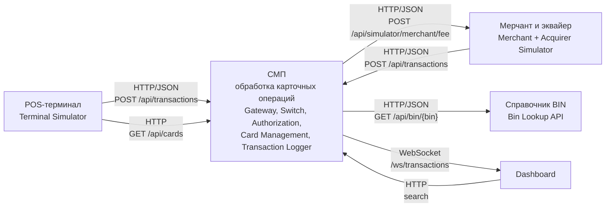

# A1. C4 Level 1 - Context

## Назначение

Показать участников

## Диаграмма

## Чего не хватало в проекте

Диаграмма контекста отсутствует полностью: `docs/architecture.md` начинается сразу с контейнерного уровня. Внешние акторы не отделены от системы, протоколы входа не зафиксированы

## Что сделано

- Выделены четыре внешних участника: POS-терминал, мерчант/эквайер, dashboard и справочник BIN.
- Показаны протоколы
- Внутренние сервисы объединены в один блок "СМП"

## Подтверждение кодом
| Утверждение | Источник |
|---|---|
| Terminal Simulator вызывает Gateway | [`GatewayClient.java`](../../../services/terminal-simulator/src/main/java/com/processing/terminalsimulator/client/GatewayClient.java) |
| Switch запрашивает комиссию эквайринга у Merchant + Acquirer | [`MerchantAcquirerClient.java`](../../../services/switch/src/main/java/com/processing/service/MerchantAcquirerClient.java) |
| Bin Lookup вызывается по `GET /api/bin/{bin}` | [`BinLookupClient.java`](../../../services/authorization/src/main/java/com/processing/authorization/client/BinLookupClient.java), [`BinLookupController.java`](../../../services/bin-lookup/src/main/java/com/processing/binlookup/controller/BinLookupController.java) |
| Dashboard получает обновления по WebSocket `/ws/transactions` | [`WebSocketConfig.java`](../../../services/transaction-logger/src/main/java/com/processing/transactionlogger/websocket/WebSocketConfig.java) |
| Состав контейнеров и порты | [`docker-compose.yaml`](../../../docker-compose.yaml) |

