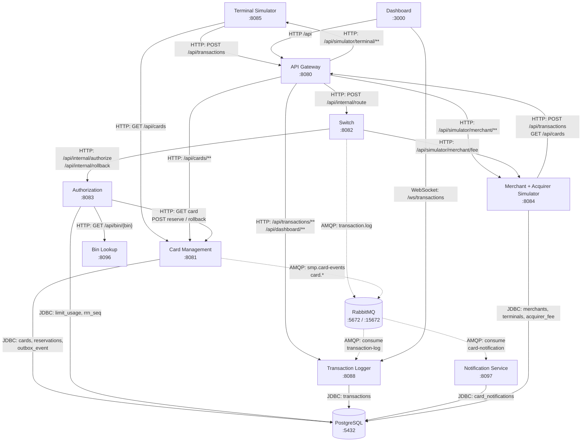

# A2. C4 Level 2 - Container

## Назначение

Показать фактический состав контейнеров и различить синхронные связи и асинхронные

## Диаграмма

## Порты сервисов

| Сервис | Порт |
|--------|:---:|
| Gateway | 8080 |
| Card Management | 8081 |
| Switch | 8082 |
| Authorization | 8083 |
| Terminal Simulator | 8085 |
| Merchant Simulator | 8084 |
| Transaction Logger | 8088 |
| Bin Lookup | 8096 |
| Notification Service | 8097 |
| Dashboard | 3000 |
| PostgreSQL | 5432 |
| RabbitMQ (AMQP) | 5672 |
| RabbitMQ (Management UI) | 15672 |

## Чего не хватало в проекте

В `docs/architecture.md` есть схема контейнеров, но:
1. связи не размечены на синхронные (HTTP) и асинхронные (AMQP);
2. outbox-публикация не отражена;
3. отсутствуют связи, которые есть в коде: `switch -> merchant-acquirer` (запрос комиссии) и `terminal-simulator -> card-management`;

## Что сделано

- Собрана схема по `docker-compose.yaml`, `application.yml`/`application.properties`.
- Все связи разделены на HTTP, JDBC, AMQP (пунктир) и WebSocket.

## Верификация по коду

| Утверждение | Источник |
|---|---|
| Маршруты Gateway | [`application.yml` gateway](../../../services/gateway/src/main/resources/application.yml) |
| Состав и порты контейнеров | [`docker-compose.yaml`](../../../docker-compose.yaml) |
| AMQP-публикация Switch | [`LoggerClient.java`](../../../services/switch/src/main/java/com/processing/service/LoggerClient.java) |
| Outbox | [`OutboxEventProcessorImpl.java`](../../../services/card-management/src/main/java/com/processing/cardmanagement/services/OutboxEventProcessorImpl.java) |
| AMQP-потребители | [`TransactionLogListener.java`](../../../services/transaction-logger/src/main/java/com/processing/transactionlogger/listener/TransactionLogListener.java), [`CardEventListener.java`](../../../services/notification-service/src/main/java/com/processing/notification/listener/CardEventListener.java) |
| WebSocket Dashboard | [`WebSocketConfig.java`](../../../services/transaction-logger/src/main/java/com/processing/transactionlogger/websocket/WebSocketConfig.java) |

