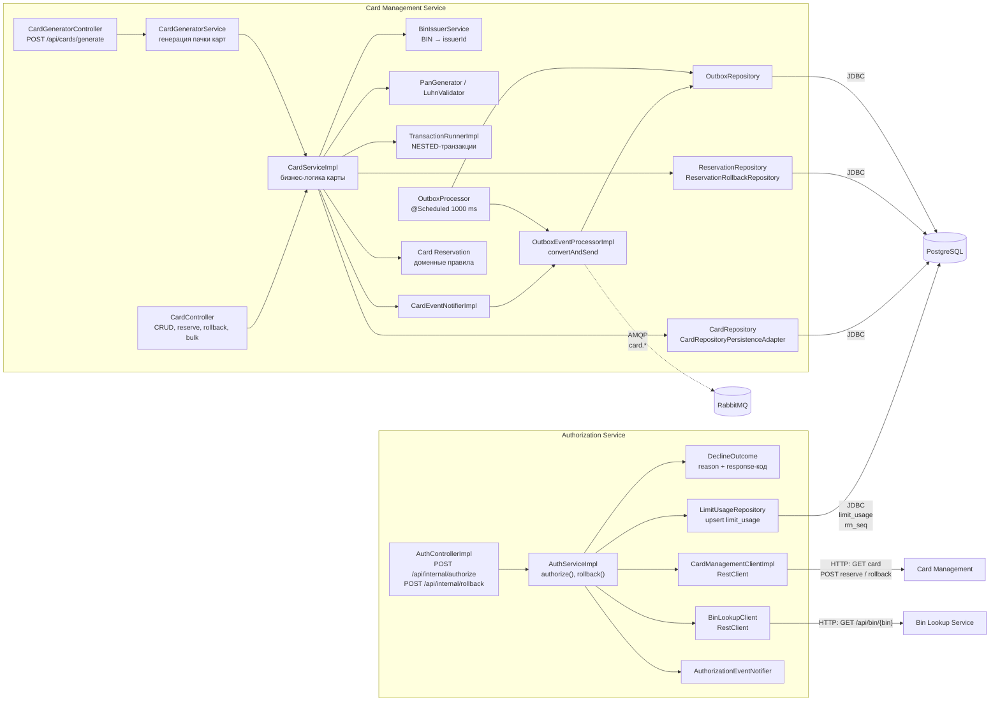

# A3. C4 Level 3 - Component: Authorization и Card Management

## Назначение

Показать внутреннее устройство двух ключевых сервисов

## Диаграмма

## Чего не хватало в проекте

Компонентного уровня в документации не было вообще: были только названия сервисов и общая схема.

## Что сделано

- Нарисованы два компонентных графа: Authorization и Card Management.
- Отмечены типы вызовов
## Верификация по коду

| Утверждение | Источник |
|---|---|
| Authorization | [`AuthControllerImpl.java`](../../../services/authorization/src/main/java/com/processing/authorization/controller/AuthControllerImpl.java), [`AuthServiceImpl.java`](../../../services/authorization/src/main/java/com/processing/authorization/services/AuthServiceImpl.java) |
| HTTP-клиент CMS | [`CardManagementClientImpl.java`](../../../services/authorization/src/main/java/com/processing/authorization/client/CardManagementClientImpl.java) |
| BIN-клиент и таймауты | [`BinLookupClient.java`](../../../services/authorization/src/main/java/com/processing/authorization/client/BinLookupClient.java) |
| UPSERT лимитов | [`LimitUsageRepository.java`](../../../services/authorization/src/main/java/com/processing/authorization/repositories/LimitUsageRepository.java) |
| Таблица отказов | [`DeclineOutcome.java`](../../../services/authorization/src/main/java/com/processing/authorization/constants/DeclineOutcome.java) |
| CRUD и reserve/rollback | [`CardController.java`](../../../services/card-management/src/main/java/com/processing/cardmanagement/controllers/CardController.java), [`CardServiceImpl.java`](../../../services/card-management/src/main/java/com/processing/cardmanagement/services/CardServiceImpl.java) |
| Генерация PAN | [`CardGeneratorService.java`](../../../services/card-management/src/main/java/com/processing/cardmanagement/services/CardGeneratorService.java), [`LuhnValidator.java`](../../../services/card-management/src/main/java/com/processing/cardmanagement/services/LuhnValidator.java) |
| Outbox | [`CardEventNotifierImpl.java`](../../../services/card-management/src/main/java/com/processing/cardmanagement/events/CardEventNotifierImpl.java), [`OutboxEventProcessorImpl.java`](../../../services/card-management/src/main/java/com/processing/cardmanagement/services/OutboxEventProcessorImpl.java), [`OutboxProcessor.java`](../../../services/card-management/src/main/java/com/processing/cardmanagement/services/OutboxProcessor.java) |
| Транзакции CMS | [`TransactionRunnerImpl.java`](../../../services/card-management/src/main/java/com/processing/cardmanagement/services/TransactionRunnerImpl.java) |

