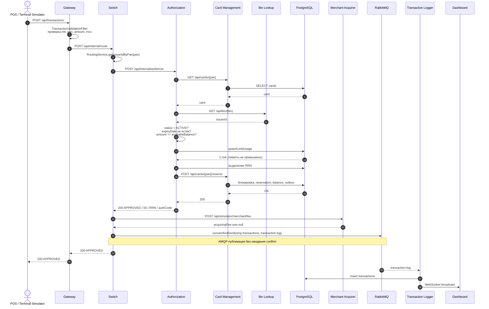
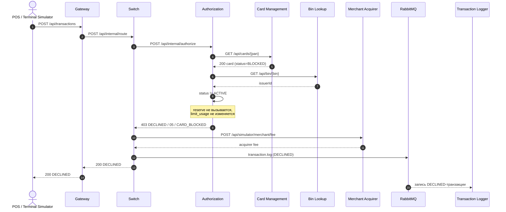
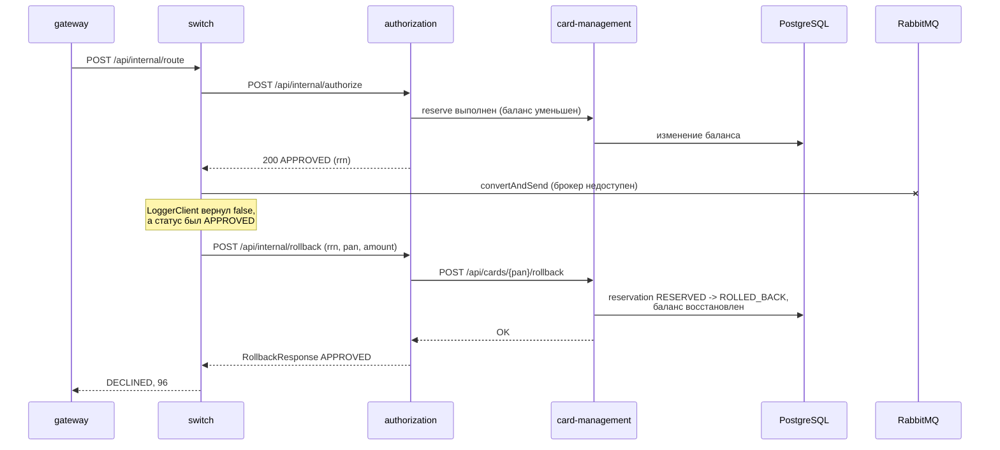

# A4. Sequence - путь транзакции

## Happy path

## Declined: карта BLOCKED

## Reversal (сбой публикации в очередь после APPROVED)

## Чего не хватало в проекте

В `docs/architecture.md` был только happy path. Не было видно:

- где именно синхронная цепочка обрывается при `declined`;
- как фактически устроен откат резерва при сбое публикации в RabbitMQ;
- в какой момент транзакция уходит в асинхронный канал и что при этом не ждётся подтверждение брокера.

## Что сделано

- Построены три sequence-диаграммы: happy path, declined и reversal.
- Выделена асинхронная часть

## Верификация по коду

| Утверждение | Класс/файл |
|---|---|
| Маршрут `/api/transactions` → `/api/internal/route` | [`application.yml` gateway](../../../services/gateway/src/main/resources/application.yml) |
| Оркестрация, BIN, публикация, rollback | [`RouteService.java`](../../../services/switch/src/main/java/com/processing/service/RouteService.java), [`AuthorizationClient.java`](../../../services/switch/src/main/java/com/processing/service/AuthorizationClient.java) |
| Проверки карты, лимитов, reserve, rollback | [`AuthServiceImpl.java`](../../../services/authorization/src/main/java/com/processing/authorization/services/AuthServiceImpl.java) |
| HTTP-клиент CMS | [`CardManagementClientImpl.java`](../../../services/authorization/src/main/java/com/processing/authorization/client/CardManagementClientImpl.java) |
| UPSERT `limit_usage` | [`LimitUsageRepository.java`](../../../services/authorization/src/main/java/com/processing/authorization/repositories/LimitUsageRepository.java) |
| Публикация в RabbitMQ | [`LoggerClient.java`](../../../services/switch/src/main/java/com/processing/service/LoggerClient.java) |
| Потребление Logger | [`TransactionLogListener.java`](../../../services/transaction-logger/src/main/java/com/processing/transactionlogger/listener/TransactionLogListener.java), [`TransactionService.java`](../../../services/transaction-logger/src/main/java/com/processing/transactionlogger/service/TransactionService.java) |
| Rollback в CMS | [`CardServiceImpl.java`](../../../services/card-management/src/main/java/com/processing/cardmanagement/services/CardServiceImpl.java), [`Reservation.java`](../../../services/card-management/src/main/java/com/processing/cardmanagement/models/Reservation.java) |
