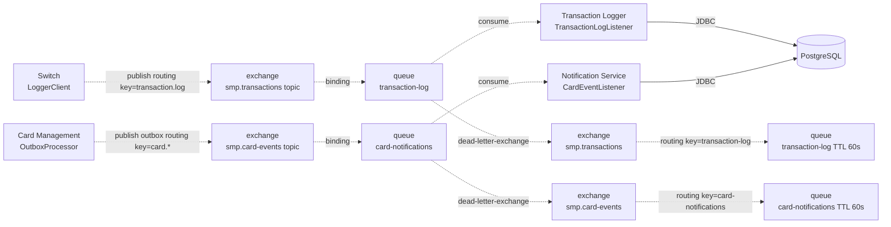

# A5. RabbitMQ-топология

## Топология

## Чего не хватало в проекте

- В `docs/architecture.md` есть текстовая таблица топологии, но не было диаграммы

## Что сделано

- Нарисована полная топология с двумя exchange, двумя основными очередями, DLX/DLQ.

## Механика надёжности
1. **Повторные доставки**: `x-max-delivery=3` на обеих очередях - при исключении в consumer'е сообщение переотправляется до 3 раз, затем уходит в DLX/DLQ. DLQ живут 60 секунд (диагностика).

## Верификация по коду

| Утверждение | Класс/файл |
|---|---|
| Топология `smp.transactions`, DLX, DLQ, TTL | [`RabbitMQConfig.java` switch](../../../services/switch/src/main/java/com/processing/config/RabbitMQConfig.java) |
| Дублирование топологии у потребителя | [`RabbitMQConfig.java` logger](../../../services/transaction-logger/src/main/java/com/processing/transactionlogger/config/RabbitMQConfig.java) |
| Публикация транзакции | [`LoggerClient.java`](../../../services/switch/src/main/java/com/processing/service/LoggerClient.java) |
| Потребление транзакции | [`TransactionLogListener.java`](../../../services/transaction-logger/src/main/java/com/processing/transactionlogger/listener/TransactionLogListener.java) |
| Топология card events | [`RabbitMQConfig.java` CMS](../../../services/card-management/src/main/java/com/processing/cardmanagement/config/RabbitMQConfig.java), [`RabbitMQConfig.java` notification](../../../services/notification-service/src/main/java/com/processing/notification/config/RabbitMQConfig.java) |
| Outbox и retry | [`CardEventNotifierImpl.java`](../../../services/card-management/src/main/java/com/processing/cardmanagement/events/CardEventNotifierImpl.java), [`OutboxEventProcessorImpl.java`](../../../services/card-management/src/main/java/com/processing/cardmanagement/services/OutboxEventProcessorImpl.java), [`OutboxProcessor.java`](../../../services/card-management/src/main/java/com/processing/cardmanagement/services/OutboxProcessor.java) |
| Потребление card events | [`CardEventListener.java`](../../../services/notification-service/src/main/java/com/processing/notification/listener/CardEventListener.java) |
