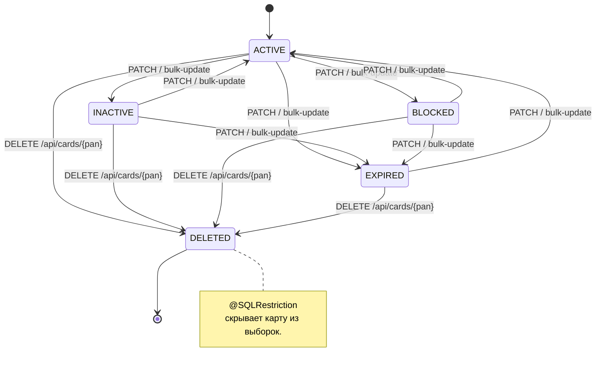
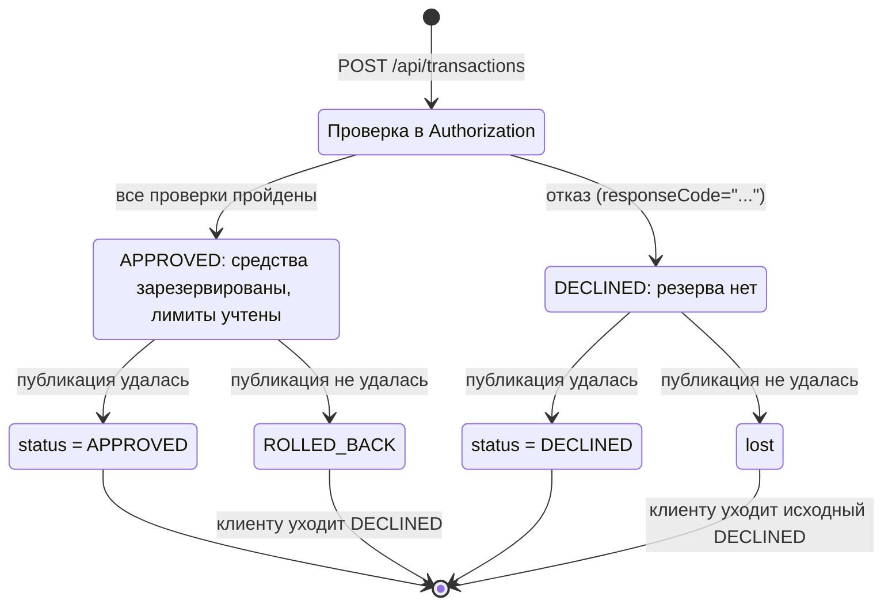

# A6. State-transition

## Card.status

## Жизненный цикл Transaction

## Чего не хватало в проекте

- Не было state-диаграмм.
- Не было переходов статусов карты.

## Что сделано

- Построена диаграмма состояний карты с переходами.
- Построена схема жизненного цикла транзакции

## Верификация по коду

| Утверждение                       | Класс/файл |
|-----------------------------------|---|
| `CardStatus`                      | [`CardStatus.java`](../../../services/card-management/src/main/java/com/processing/cardmanagement/models/CardStatus.java) |
| Переходы карты                    | [`Card.java`](../../../services/card-management/src/main/java/com/processing/cardmanagement/models/Card.java), [`CardServiceImpl.java`](../../../services/card-management/src/main/java/com/processing/cardmanagement/services/CardServiceImpl.java) |
| `@SQLRestriction` для DELETED     | [`CardEntity.java`](../../../services/card-management/src/main/java/com/processing/cardmanagement/models/CardEntity.java) |
| `ReservationStatus`               | [`ReservationStatus.java`](../../../services/card-management/src/main/java/com/processing/cardmanagement/models/ReservationStatus.java) |
| Переходы резерва                  | [`Reservation.java`](../../../services/card-management/src/main/java/com/processing/cardmanagement/models/Reservation.java) |
| `TransactionStatus`               | [`TransactionStatus.java`](../../../services/common/src/main/java/com/processing/common/dto/transactionlogger/TransactionStatus.java) |
| Сохранение статуса без обновления | [`TransactionService.java`](../../../services/transaction-logger/src/main/java/com/processing/transactionlogger/service/TransactionService.java) |
| Откат             | [`RouteService.java`](../../../services/switch/src/main/java/com/processing/service/RouteService.java) |
