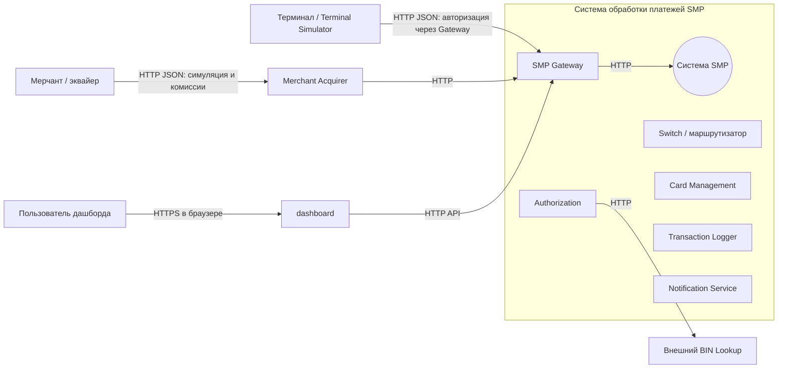

# А1. C4 Level 1 — Context

## Диаграмма

## Чего не хватало и что добавлено
- **Не хватало:** контекстной диаграммы с границей системы, внешними акторами и протоколами.
- **Добавлено:** терминал, мерчант/эквайер, пользователь дашборда, внешний BIN Lookup и подписи протоколов. Вход транзакции идёт через Gateway; внутренний BIN lookup вызывается Authorization по HTTP.

## Подтверждение в коде
- `services/docker-compose.yaml` — сервисы `gateway`, `terminal-simulator`, `merchant-acquirer`, `dashboard`, `bin-lookup`.
- `services/gateway/src/main/java/com/processing/gateway/` — фильтры и маршрутизация Gateway.
- `services/switch/src/main/java/com/processing/service/RouteService.java` — входная оркестрация, BIN-routing и вызов Authorization.
- `services/authorization/src/main/java/com/processing/authorization/client/BinLookupClient.java` — HTTP-клиент BIN Lookup.
- `services/terminal-simulator/src/main/java/com/processing/terminalsimulator/client/GatewayClient.java` и `services/merchant-acquirer/src/main/java/com/processing/merchantacquirer/client/GatewayClient.java` — вызовы Gateway.
- `services/dashboard/src/` — пользовательский интерфейс.
