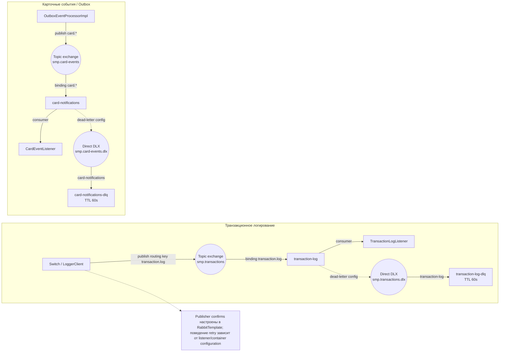

# А5. RabbitMQ topology

## Диаграмма

## Чего не хватало и что добавлено
- **Не хватало:** визуальной схемы exchange → queue → consumer, DLX/DLQ, TTL и подтверждения публикации.
- **Добавлено:** две независимые топологии (транзакции и события карт), routing keys, dead-letter маршруты и TTL 60 секунд для DLQ.

## Подтверждение в коде
- `services/switch/src/main/java/com/processing/config/RabbitMQConfig.java` — `smp.transactions`, `transaction-log`, DLX/DLQ.
- `services/switch/src/main/java/com/processing/service/LoggerClient.java` — producer.
- `services/switch/src/main/resources/application.yml` — correlated publisher confirms.
- `services/transaction-logger/src/main/java/com/processing/transactionlogger/config/RabbitMQConfig.java` — очередь и binding.
- `services/transaction-logger/src/main/java/com/processing/transactionlogger/listener/TransactionLogListener.java` — consumer.
- `services/card-management/src/main/java/com/processing/cardmanagement/config/RabbitMQConfig.java` — card exchange, queue, DLX/DLQ, TTL и RabbitTemplate.
- `services/card-management/src/main/java/com/processing/cardmanagement/services/OutboxEventProcessorImpl.java` — producer.
- `services/notification-service/src/main/java/com/processing/notification/config/RabbitMQConfig.java`, `.../listener/CardEventListener.java` — consumer.
