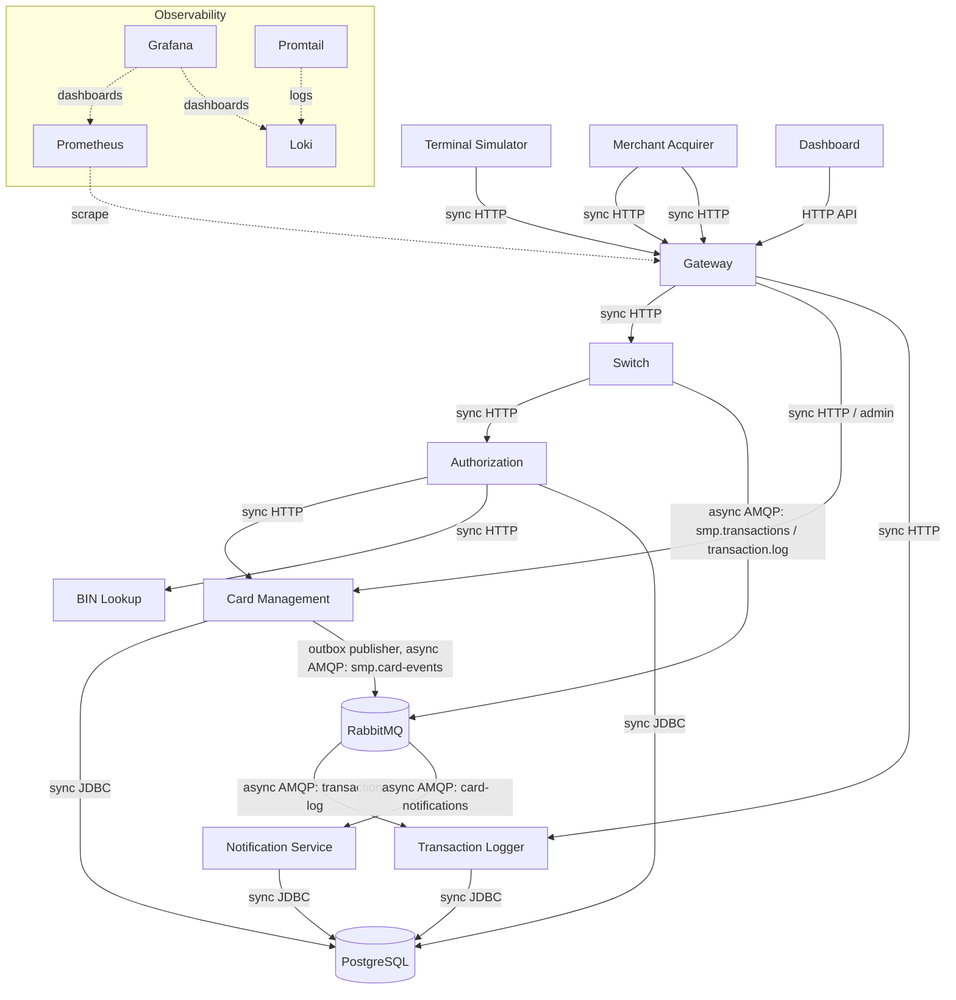

# А2. C4 Level 2 — Container

## Диаграмма

## Чего не хватало и что добавлено
- **Не хватало:** пометок sync/async, очередей/exchange, outbox и publisher confirms, сверки с Compose.
- **Добавлено:** HTTP и JDBC показаны как синхронные взаимодействия; AMQP — как асинхронные. Отражены оба потока RabbitMQ: `smp.transactions` → `transaction-log` и `smp.card-events` → `card-notifications`.

## Подтверждение в коде
- `docker-compose.yaml` — контейнеры, environment URL, сети и зависимости.
- `services/switch/src/main/java/com/processing/service/RouteService.java` — синхронный маршрут и async-публикация.
- `services/switch/src/main/java/com/processing/service/LoggerClient.java` и `services/switch/src/main/java/com/processing/config/RabbitMQConfig.java` — exchange/queue и публикация.
- `services/transaction-logger/src/main/java/com/processing/transactionlogger/config/RabbitMQConfig.java`, `.../listener/TransactionLogListener.java` — consumer Logger.
- `services/card-management/src/main/java/com/processing/cardmanagement/config/RabbitMQConfig.java`, `.../services/OutboxEventProcessorImpl.java` — outbox publisher и события карт.
- `services/notification-service/src/main/java/com/processing/notification/config/RabbitMQConfig.java`, `.../listener/CardEventListener.java` — очередь уведомлений.
- `services/authorization/src/main/java/com/processing/authorization/client/` — HTTP-клиенты.
