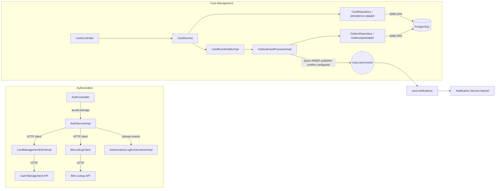

# А3. C4 Level 3 — Component: Authorization и Card Management

## Диаграмма

## Чего не хватало и что добавлено
- **Не хватало:** внутренних компонентов двух сервисов и явного разделения controller/service/client/repository.
- **Добавлено:** в Authorization показаны контроллер, сервис и HTTP-клиенты; в Card Management — контроллер, бизнес-сервис, persistence и outbox-публикация.

## Подтверждение в коде
- `services/authorization/src/main/java/com/processing/authorization/controller/AuthController.java` и реализация контроллера в том же пакете.
- `services/authorization/src/main/java/com/processing/authorization/services/AuthServiceImpl.java`.
- `services/authorization/src/main/java/com/processing/authorization/client/CardManagementClientImpl.java`, `BinLookupClient.java`.
- `services/card-management/src/main/java/com/processing/cardmanagement/controllers/CardController.java`.
- `services/card-management/src/main/java/com/processing/cardmanagement/services/CardService.java` и реализация `CardServiceImpl.java`.
- `services/card-management/src/main/java/com/processing/cardmanagement/events/CardEventNotifierImpl.java`.
- `services/card-management/src/main/java/com/processing/cardmanagement/services/OutboxEventProcessorImpl.java`.
- `services/card-management/src/main/java/com/processing/cardmanagement/repositories/OutboxRepository.java`, `OutboxJpaAdapter.java`.
- `services/card-management/src/main/resources/db/migration/V5.5__init_outbox_events_table.sql`.
