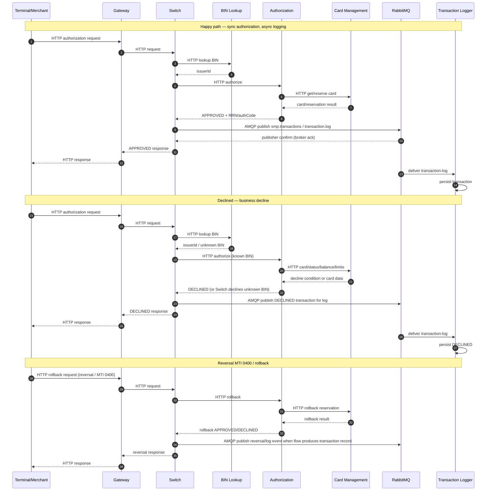

# А4. Sequence — happy path, declined, reversal (MTI 0400)

## Диаграмма

## Чего не хватало и что добавлено
- **Не хватало:** только happy path; не были сопоставлены отказ и reversal.
- **Добавлено:** три сценария, граница sync/async, publisher confirm, rollback при недоступности публикации.

## Подтверждение в коде
- `services/switch/src/main/java/com/processing/service/RouteService.java` — последовательность routing → authorize → logging и rollback при неуспешной публикации.
- `services/switch/src/main/java/com/processing/service/AuthorizationClient.java` — HTTP authorize/rollback (в коде rollback формируется отдельным `RollbackRequest`; литерал MTI 0400 не найден).
- `services/switch/src/main/java/com/processing/service/LoggerClient.java` — AMQP publish.
- `services/switch/src/main/resources/application.yml` — `publisher-confirm-type: correlated`.
- `services/authorization/src/main/java/com/processing/authorization/controller/AuthController.java` — authorize/rollback endpoints.
- `services/authorization/src/main/java/com/processing/authorization/services/AuthServiceImpl.java` — логика rollback.
- `services/common/src/main/java/com/processing/common/dto/transactionlogger/TransactionStatus.java` — только `APPROVED`, `DECLINED`.
- Проверка фактического reversal-контракта: `docs/api-spec.md` и `services/common/src/main/java/com/processing/common/dto/authorization/RollbackRequest.java`.
