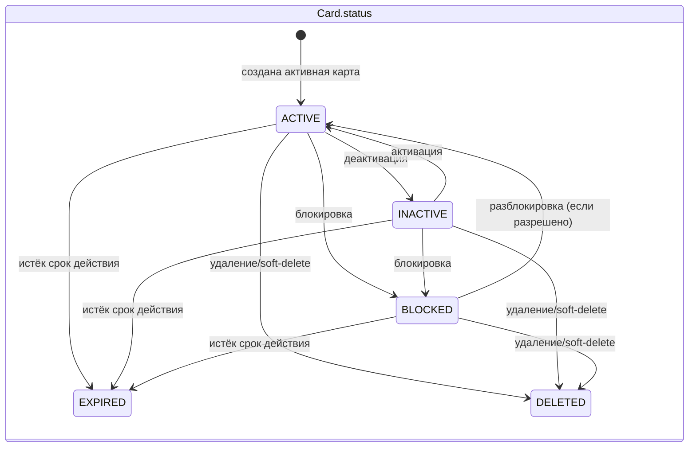
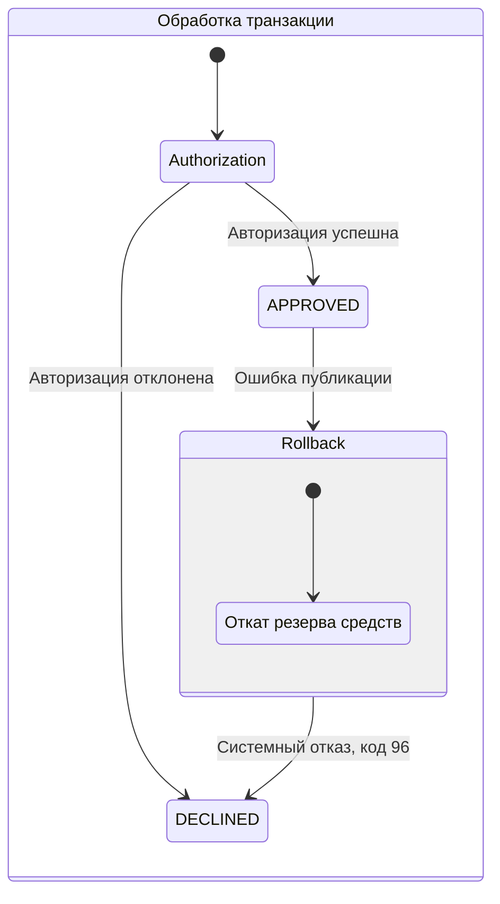

# А6. State transitions — Card и Transaction

## Диаграмма

## Чего не хватало и что добавлено
- **Не хватало:** диаграммы состояний карты и жизненного цикла транзакции.
- **Добавлено:** состояния карты, статусы транзакции и отдельно статусы Outbox.

## Подтверждение в коде
- `services/card-management/src/main/java/com/processing/cardmanagement/models/CardStatus.java` — enum статусов карты.
- `services/common/src/main/java/com/processing/common/dto/cardmanagement/CardModelStatus.java` — статусы в API DTO.
- `services/card-management/src/main/java/com/processing/cardmanagement/services/CardServiceImpl.java` — операции над картами.
- `services/common/src/main/java/com/processing/common/dto/transactionlogger/TransactionStatus.java` — статусы транзакции.
- `services/transaction-logger/src/main/resources/db/migration/V1__create_transactions_table.sql` — ограничение БД `APPROVED`, `DECLINED`.
- `services/card-management/src/main/java/com/processing/cardmanagement/models/OutboxEventDataStatus.java` и `CardOutboxEventData.java` — состояния outbox.
